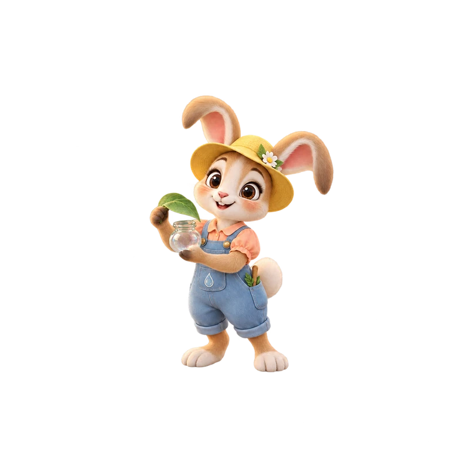
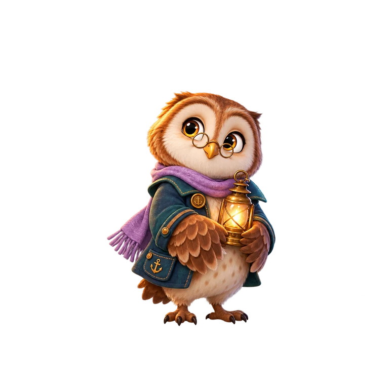
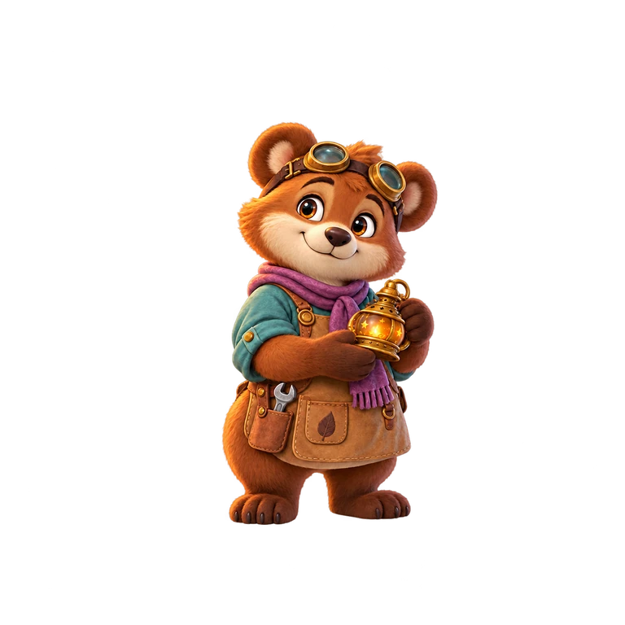
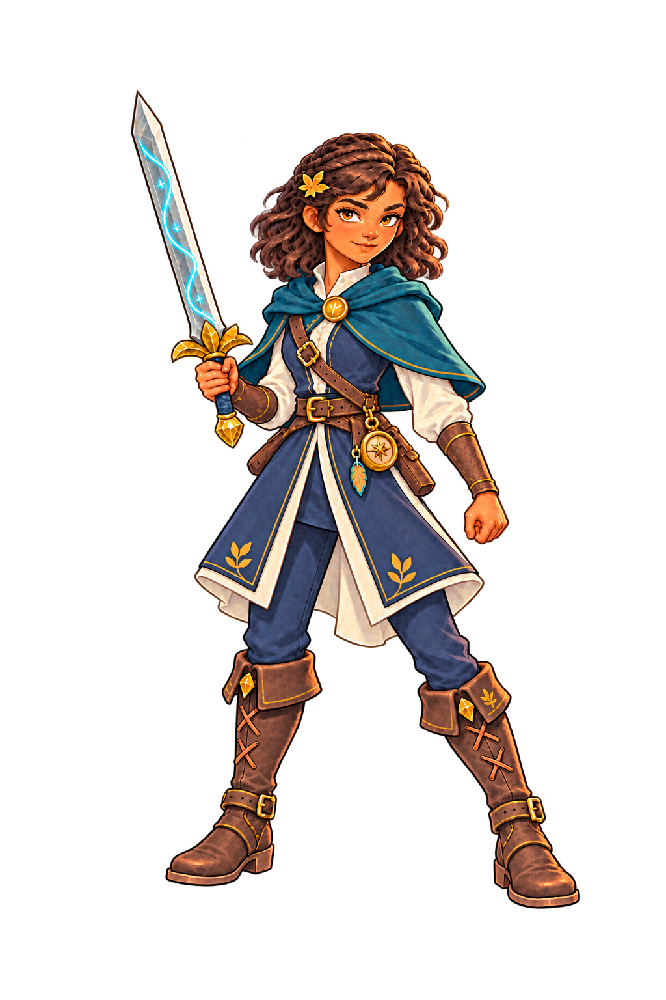
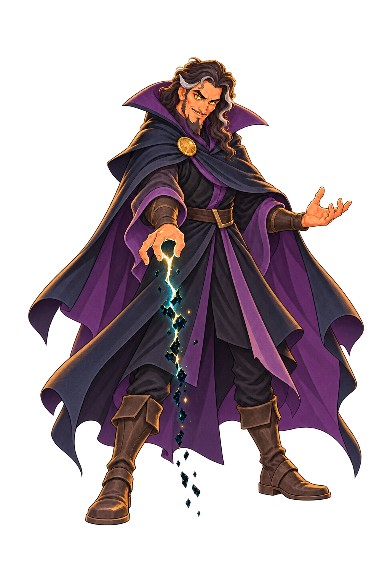

# 暮光森林角色圖鑑

[世界觀](README.md) · [美術來源與重建](art/README.md)

## 角色速覽

| 米洛 | 露米 | 奧利 |
| --- | --- | --- |
|  |  |  |

| 諾爾 | 菲恩 | 布諾 |
| --- | --- | --- |
|  |  |  |

### 上古傳說人物

| 黎薇｜勇者 | 赫恩｜奪輝王 |
| --- | --- |
|  |  |

兩人屬於暮光森林的上古傳說，與現代居民的造型差異來自年代。共同歷史只見[世界觀](README.md#上古傳說與今日和平)，本頁維護人物身分、個性與辨識。

## 身分與口吻

| 角色 | 身分與個性 | 說話方式／示例 | 可延伸的小細節 |
| --- | --- | --- | --- |
| 米洛 | 人類工坊學徒；好奇、親切，怕讓人失望時容易搶著答應 | 邀請一起觀察，願意承認不知道。「我們先看看，哪裡還有空間？」 | 習慣替朋友留位置，也在練習替自己留下求助的餘地 |
| 露米 | 兔子露珠採集師；敏銳、活潑，常因捨不得錯過而分心 | 輕快、具體，不堆疊幼兒語。「這顆露珠，像剛睡醒的星星！」 | 最大的露珠叫「小小」；口袋有給雲的糖 |
| 奧利 | 鹿森林郵差；可靠、體貼，容易把送不到信當成自己的過錯 | 清楚、爽朗，帶來消息而不催促。「蝸牛的請帖，我提早送。」 | 郵袋有裝迷路的風的暗袋；保護收信人的隱私 |
| 諾爾 | 貓頭鷹星燈看守人；安靜、細心，有時把自己的需要藏得太好 | 短句、留白，先詢問再陪伴。「這盞燈，留給晚歸的人。」 | 替怕黑的燈做夜燈；也需要朋友提醒他休息 |
| 菲恩 | 狐狸草藥師；靈巧、愛研究，對有把握的發現偶爾太急著下結論 | 以氣味、葉片與觀察說話，分清猜想與發現。「配方這一格，留給新發現。」 | 落葉當書籤；保留失敗筆記與配方空白 |
| 布諾 | 熊火光修理師；穩重、耐心，常比物主更捨不得放下舊物 | 樸實、有夥伴感，動手前先問。「沒關係，搭檔。我們再試一回。」 | 工具箱裡睡著小貓；珍藏一顆被說成能修心情的螺絲 |
| 黎薇 | 上古勇者；沉著、勇敢，在意同行者，也曾把保護誤認為獨自承擔 | 先說清風險，再邀同伴決定；口吻示例見下方，完整遊戲台詞未接入 | 這個魔法世界唯一持劍的勇者；現在的下落未定案 |
| 赫恩 | 上古魔王，稱號「奪輝王」；細密、自律，因害怕失控而剝奪他人的選擇 | 論述冷靜、善用承諾施壓；口吻示例見下方，完整遊戲台詞未接入 | 過往能解釋動機，不能免除責任；具體能力規則仍未定案 |

## 角色故事與內在動機

以下是共用人物設定，供後續故事與台詞取用；背景經歷不代表已做成任務。角色在工坊的短對話只露出當下需要的一小部分，完整台詞仍以 [story.ts](../../src/games/magic-workshop/story.ts) 為準。

### 米洛：想成為值得託付的人

米洛剛到工坊時，曾自告奮勇替一場聚會準備迎賓燈。她忙著試出更漂亮的光，卻忘了問燈要掛在哪裡；直到奧利拿著送信路線來，她才發現，低處的小徑仍是一片暗。那晚大家一起重新安排燈的位置，沒有人替她掩飾疏忽，也沒有人把她趕離工作台。

她留下來當學徒，起初想證明自己也有本事，如今更想聽懂每份委託背後的需要。遇到別人失望，她仍會急著說「交給我」，甚至把還沒想好的方法說得很肯定。她的成長發生在願意改口的那一刻：「這一步我還不會，我們一起看看。」她陪玩家嘗試，也會請玩家幫忙，不搶走解開問題的機會。

工坊裡，她總先多留一張椅子；忙到把自己那張椅子堆滿雜物時，布諾便會替她清出來。寫她的失誤要有具體原因與補救，保留她提出點子、動手與判斷的能力，不能讓她只會驚嘆或等人教。

### 露米：珍惜，也包括留下

露米喜歡在清晨採集露珠。她能分辨葉尖將落未落的水滴，也會發現朋友換了一條縫線。以前，她總想把最漂亮的露珠全帶回去；有次罐子裝滿了，回程卻沒能看見那片葉子在晨光裡的樣子。從此她出門仍帶著罐子，卻不再以裝滿為一天的成果。

她想讓容易被錯過的小事有人看見，因此常把採集途中遇見的聲音、氣味與故事帶進工坊。她的難處是每件事都捨不得錯過：答應替菲恩看種子，又被一滴奇形怪狀的露珠引走。她需要學著完成承諾、告訴朋友自己做不到什麼，也接受美好的東西不一定能留下。

最大的露珠叫「小小」，因為她第一次看見它時，它還很小；名字留下的是相遇的記憶。給雲的糖則是她的玩笑與心意，不設定成改變天氣的配方。她能細心，也能急躁，不因活潑就總是粗心闖禍。

### 奧利：送達之後，留一點時間

奧利剛送信時，把準時抵達當成最重要的事。一次遞信後，他急著趕往下一站，沒聽見收信人輕聲叫他；回程才知道，對方看不清信上的小字，原本想請他讀一讀。此後他會提前送出需要準備的消息，遞信後也多問一句：「需要我留下來幫忙嗎？」

他希望每位居民都能與別人保持聯繫，卻不能替收信人決定何時回信。送不到信時，他容易往自己身上找原因，繞遠路也不肯求助。諾爾會替他保留晚歸的燈，提醒他一天的工作可以結束，尚未寄出的話也能等到明天。

郵袋的暗袋被他稱作「迷路的風的座位」：風吹起信角時，他就這樣向新朋友解釋。空白郵票留給還沒說出口的謝謝，不催任何人使用。他知道許多消息，卻不拆信、不以郵差身分替別人洩露心事；可靠也包含守住這條界線。

### 諾爾：照亮一段路，不替人選方向

諾爾起初照看星燈時，曾以為越亮越好。後來一位晚歸的居民告訴他，燈雖然亮，迎面看卻找不到腳下的邊界。他於是走過每段小徑，蹲下來看低處的光，再調整燈的位置。他最在意的不是遠處有多耀眼，而是走到燈下的人，能不能看清下一步。

他記得朋友回家的習慣，卻不把沉默一律當成難過。有人停在路邊，他會先問想獨處還是有人陪。有時他太擅長照顧別人，輪到自己疲倦卻只說「再一盞就好」。他的成長是願意把提燈交給朋友，也相信自己休息時，森林仍有人照看。

「替怕黑的燈做夜燈」是露米聽過後很喜歡的說法，指的是他留在工作處的小燈。諾爾的話可以有詩意，但要指向眼前的事，不讓他每次出場都說寓言，或憑沉默猜中所有人的心。

### 菲恩：讓下一次觀察有地方落筆

菲恩最珍惜的筆記本，曾被他寫得密密麻麻。他照著一份成功紀錄照顧新種子，卻遲遲等不到嫩芽；直到露米指出兩盆土聞起來不同，他才翻回筆記，發現自己只記了配方，沒記環境，也沒寫下當時不確定的事。

他想弄懂植物與魔法如何一起回應照料，現在每份紀錄都留白，連失敗也不撕掉。可是一有新發現，他仍會興奮得說得太快，聽見質疑時也會先護著自己的推論。他需要練習把「我猜」與「我看見」分開，邀別人重做觀察，而不是用一串術語贏得爭論。

落葉書籤記著採集當天的季節與天氣；布諾替筆記本補過的書脊，讓那些不漂亮的舊頁也能留下。他可以有自信與幽默，不固定扮演一切問題的專家。虛構草藥只服務故事，不為角色增加能替代真實醫療的能力。

### 布諾：先聽物主想留下什麼

布諾年輕時替人修過一盞舊燈。他把凹陷敲平、把褪色的外殼換新，燈重新亮了，物主卻摸著光滑的提把沉默很久。那道被磨掉的小刻痕，原來是家人留下的記號。布諾從此在拆開物件前，先問對方想留下什麼；他修好的物件，也會留著使用過的痕跡。

他希望朋友帶著壞掉的東西走進來時，不必先為自己的笨拙道歉。然而，耐心也有固執的一面：他有時捨不得承認一件物品已不適合繼續使用，反覆修補，忘了詢問物主是否想換新的。他正在學著說明限制，讓對方參與決定，也容許自己停手。

他珍藏的螺絲來自一次與米洛共同完成的小修理。「修心情」是朋友的暱稱；讓人安心的是一起做成的經驗。小貓偶爾睡進收工後的空工具格，他便晚一點整理。穩重不等於永不生氣，他可以皺眉、需要安靜，再回來把話說清楚。

### 黎薇：把回家的方向交還給同行者

成為勇者前，黎薇常替同行的人辨認道路。她帶的羅盤用來校準方向，不能替她知道每條路的盡頭。一次漫長的護送途中，她怕同伴擔心，獨自收下所有風險與決定；直到疲倦使她判斷失準，才明白不讓別人參與，也會讓整隊人失去準備的機會。

她後來學會在出發前說明自己知道與不知道的事，讓願意同行的人各自承擔能做的部分。她的勇敢在於知道害怕仍能行動；她的缺點則是在危急時重新把責任攬回來，以為只要自己留下，其他人便都能平安。羅盤對她的意義，是提醒自己記得來路與同行的人，不新增尋人或預知能力。

黎薇與赫恩曾在同一場魔法失控後的修復行動中合作。她敬重他的細心，也曾相信更嚴密的安排能避免所有意外；當他開始收走居民使用魔法的權利，她才看清兩人對「保護」的理解已分開。她最終擊敗並封印赫恩，守住居民重新生活與作選擇的可能。這段背景不設定兩人為親屬、戀人或固定師徒，也不把勝利寫成她一人包辦所有人的貢獻。

口吻示例：「前面還有我沒看清的地方。我們先把知道的事說出來。」她能猶豫、改變計畫、接受別人的好意，不必每句話都像誓言。現代下落與封印現況維持未定案；這些經歷也不新增戰鬥技能或獎勵。

### 赫恩：容不下意外的人

赫恩曾整理魔法的使用紀錄，擅長從細節中發現危險。他親眼見過魔法失控造成傷害，參與修復後仍反覆回想：若自己早一點發現，是否就能阻止？最初，他的檢查確實幫了許多人，也使他逐漸認定，只有自己會把所有後果想到底。

他想建立不再有人受傷的秩序，卻越來越不能忍受別人的方法與自己的不同。他先替人決定什麼風險值得冒，後來乾脆否定別人使用魔法的資格；被拒絕時，他把拒絕當成對方需要被管束的證明。「奪輝王」指向他奪走他人光芒與自主的歷史，不直接定義吸光、奪能或封印的具體機制。

他與黎薇共享過修復世界的願望，因此她的反對比陌生人的抵抗更令他動搖。他看得見她過度承擔的弱點，會以「讓我替你決定，你就不必再害怕」來勸服她。當她選擇把判斷與責任交還同伴，他卻把這看成放任危險。這是兩人的核心衝突；他的經歷說明執念如何形成，不替脅迫與剝奪辯護。

口吻示例：「交給我決定，你們就不必再承擔後果。」平常措辭完整、少抬高聲音，遇到無法控制的選擇時才顯出急迫。他可以有值得理解的恐懼，也必須對自己的行為負責；不預設洗白、復活或現代再臨，具體能力仍待遊戲設計確認。

## 居民之間的關係

| 關係 | 彼此需要什麼，也容易在哪裡不同意 |
| --- | --- |
| 米洛與布諾 | 一起修東西的搭檔。布諾替米洛保留試做的機會；米洛也會問他是否該休息。兩人都容易接下太多事，要練習一起說明做不到的部分。 |
| 露米與諾爾 | 常在清晨交班時碰面。露米把新鮮事帶給守夜的諾爾；他讓她發現，安靜也能一起度過。她有時想立刻分享，他則需要先睡一覺，兩人會約好下次再談。 |
| 奧利與諾爾 | 奧利帶回路況，諾爾照看晚歸的路。他們會確認誰需要一盞燈，卻不追問信裡的私事；兩人也互相提醒，等待不必變成整夜不休息。 |
| 露米與菲恩 | 露米擅長發現異樣，菲恩擅長留下紀錄。菲恩想照原計畫採集，露米可能停下追一個新發現；他們學著先說清今天的需要，另留時間探索。 |
| 菲恩與布諾 | 一起照料工坊的小物件。菲恩想試新材料，布諾偏好熟悉的修法；兩人會先問物主需要什麼，再討論是否值得試，不能把朋友的物品當成未經同意的實驗。 |
| 米洛與奧利 | 奧利把委託帶進工坊，也替米洛把約定說清楚。米洛希望立刻幫忙，奧利會問她何時做得完；他自己送信受阻時，也學著向她開口。 |

其他配對可從具體委託發展，不把這張表當成固定組隊。居民可以不同意、婉拒與道歉；關係透過下一次行動改變，不靠一句大道理解決。現代居民沒有已定案的上古血緣、轉世或秘密身分。

## 寫進遊戲時的分寸

- 先讓角色有眼前的需要，再用一個動作或小物透露背景。例如布諾先問是否保留刻痕，不在接單時重述整段往事。
- 每次委託讓居民自己完成一部分工作，玩家的幫助才有具體位置；不把所有人寫成離開玩家就無能為力。
- 角色成長要留下反覆與代價：道歉後要改做法，休息可能要請朋友接手；不以受傷、遺棄或羞辱作為每位角色必備的深度。
- 日常對話使用角色各自的觀察方式。露米先注意細節，奧利確認約定，諾爾問是否需要陪伴，菲恩核對猜想，布諾詢問想保留的部分，米洛邀玩家一起試。
- 魔法可以有想像與幽默，線索、容量及教材仍依程式規則；彩蛋不能成為通關所需卻未說明的條件。上古故事與現代和平分開呈現。

## 同場角色尺度

以下比例只適用於六位現代工坊居民；黎薇與赫恩的共同像素尺寸、角色比例、錨點與腳底基線仍待正式 sprite 製作時確認，不套用這份居民身高表。

角色在同一地面深度並排時，以奧利的自然站姿輪廓為 1.00 校準視覺身高；帽沿、耳尖、羽角、提燈、披風與魔法光暈不拿來決定縮放。這是跨遊戲的畫面比例基準，不是角色的公分身高；遠近透視仍由場景座標調整。各角色有頭身與體型差異，但不把任何居民畫成另一位的巨人或矮人。

| 角色 | 同深度視覺身高 | 造型差異 |
| --- | ---: | --- |
| 露米 | 約 0.96 | 兔耳高於頭頂，身體仍接近其他居民 |
| 奧利 | 1.00 | 輕巧的小鹿身形，郵袋不計入身高 |
| 諾爾 | 約 0.98 | 羽身較寬、站姿較圓，提燈不放大本體 |
| 菲恩 | 約 1.03 | 狐狸身形較修長，尾巴不計入身高 |
| 米洛 | 約 1.05 | 人類學徒略高，帽子不計入身高 |
| 布諾 | 約 1.10 | 肩背較寬厚，是這組角色中稍高的一位 |

## 造型基準與原圖

上方速覽直接引用現役 WebP；「造型母圖」連向完整 PNG 原稿，製作新圖時優先使用它。表情、步態與正視修正是同一角色的衍生姿勢，不是不同角色。原稿尺寸、提示與生成紀錄以所連的 manifest 為準；有透明殘點的早期原稿仍需重新驗收，不能把它當成已通過新動畫規格。

上古兩人的速覽直接引用已選定 PNG 母圖；像素站立圖是美術方向參考，並非已採用的遊戲素材。來源與實測尺寸見[上古素材清單](art/manifests/ancient-legend-manifest.json)。

### 米洛（milo）

栗棕捲髮、淡紫星飾巫師帽、青綠上衣、梅紫披風、棕靴與小瓶。

[造型母圖](art/characters/milo/apprentice-v2.png) · [感謝表情原圖](art/characters/milo/apprentice-celebrate-v1.png) · [造型來源紀錄](art/manifests/manifest.json)

橫向遊戲的 Q 版空手造型：[核准母圖](art/characters/milo/milo-platformer-master-v1.png) · [跑跳動畫來源與規格](art/side-scroller/manifests/sprites-manifest.json)。採右向側視與 Kenney 素材包的粗輪廓；本遊戲不攜帶小瓶，共用身分不變。

### 露米（lumi）

米色兔子、花飾草帽、桃色上衣、藍色吊帶褲；葉片與玻璃露珠罐。

[造型母圖](art/characters/lumi/visitor-rabbit-dew-v2.png) · [感謝表情原圖](art/characters/lumi/visitor-rabbit-happy-v1.png) · [造型來源紀錄](art/manifests/batch-2-manifest.json)

其他姿勢：[正視修正原圖](art/characters/lumi/guest-rabbit-front-gaze-v2.png) · [六幀步態母圖](art/characters/lumi/guest-rabbit-walk-v1.png)

### 奧利（oli）

無角小鹿、紅郵帽、芥黃上衣、米白背心、紅郵袋與信封；勿依鹿的印象自行加角。

[造型母圖](art/characters/oli/visitor-deer-post-v4.png) · [感謝表情原圖](art/characters/oli/visitor-deer-happy-v1.png) · [造型來源紀錄](art/manifests/batch-2-manifest.json)

其他姿勢：[六幀步態母圖](art/characters/oli/guest-deer-walk-v1.png)

### 諾爾（noel）

棕／米白羽毛、圓眼鏡、梅紫圍巾、青綠外套與黃銅提燈。

[造型母圖](art/characters/noel/visitor-owl-keeper-v1.png) · [感謝表情原圖](art/characters/noel/visitor-owl-happy-v1.png) · [造型來源紀錄](art/manifests/batch-2-manifest.json)

其他姿勢：[正視修正原圖](art/characters/noel/guest-owl-front-gaze-v2.png) · [六幀步態母圖](art/characters/noel/guest-owl-walk-v1.png)

### 菲恩（finn）

赤褐／米白狐狸、綠披肩、淡紫圍巾、草藥籃與側背包；保留完整尾巴。

[造型母圖](art/characters/finn/forest-visitor-v3.png) · [感謝表情原圖](art/characters/finn/visitor-fox-happy-v1.png) · [造型來源紀錄](art/manifests/manifest.json)

其他姿勢：[正視修正原圖](art/characters/finn/guest-fox-front-gaze-v2.png) · [六幀步態母圖](art/characters/finn/guest-fox-walk-v1.png)

### 布諾（bruno）

棕熊、額上護目鏡、青綠上衣、紫圍巾、棕皮工作圍裙與工具口袋，手持暖光提燈；穩重圓厚的身形。

[造型母圖](art/characters/bruno/visitor-bear-artisan-v2.png) · [感謝表情原圖](art/characters/bruno/visitor-bear-happy-v1.png) · [造型來源紀錄](art/manifests/batch-2-manifest.json)

其他姿勢：[六幀步態母圖](art/characters/bruno/guest-bear-walk-v1.png)

### 黎薇

暖棕膚色、及肩棕髮與編髮、金色髮飾、深藍服裝、及腰的藍綠披風、羅盤、發藍光的劍與棕色長靴。外觀以已選定原畫為準，不增加第二把劍或替換辨識配件。

[造型母圖](art/characters/liwei/liwei-character-master-v1.png) · [像素站立修正版參考](art/characters/liwei/liwei-pixel-idle-reference-v2.png) · [來源與素材狀態](art/manifests/ancient-legend-manifest.json)

像素版放在畫面左側、面向右；以雙手握住**同一支劍柄**的修正版為準。此圖未完成正式 sprite 的尺寸、錨點、腳底基線與透明邊緣驗收，不直接縮圖後當作已核准動畫幀。

### 赫恩

深色波浪長髮與白色髮束、鬍鬚、深色服裝、紫色內襯大披風、胸前金色扣飾與棕色長靴。造型依已選定原畫，不加入植物裝飾，也不給他劍；原畫上的魔法效果不等於已定案的能力規則。

[造型母圖](art/characters/heen/heen-character-master-v1.png) · [像素站立參考](art/characters/heen/heen-pixel-idle-reference-v1.png) · [來源與素材狀態](art/manifests/ancient-legend-manifest.json)

像素版放在畫面右側、面向左；與黎薇共用正式製作規格後再驗收，保留原畫的身形、披風與人物辨識。目前仍為參考圖，不能視為可直接切幀的正式素材。

## 使用順序

1. 先讀身分與口吻，再看造型母圖；不以姿勢修正版覆蓋人物身分。
2. 感謝表情來源見 [reactions](art/manifests/reactions-manifest.json)，客人動作見 [步態](art/manifests/guest-animation-manifest.json) 與 [正視修正](art/manifests/guest-gaze-manifest.json)。
3. 實際載入、縮放與角色順序見 [art.ts](../../src/games/magic-workshop/art.ts)；工坊出場順序不是所有遊戲必守的故事規則。
4. 新姿勢先定義格位、錨點、安全留白，原圖與每個切出幀皆須驗收；完整規範見 [AGENTS](../../AGENTS.md)。
